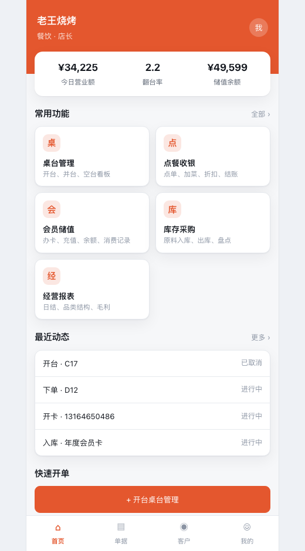

# 千行百业产品经理 Skill

一个 **Agent Skill**：任何能读 markdown、能跑 node 的 agent 接过去，就能按产品经理的方式干活——问清楚业务，写出能开工的 PRD，再产出能点的 PC 工作台和手机上能看的 H5。

覆盖 **143 个行业**（78 门店 + 65 公司）、**613 个业务模块**，全部由原型组合生成。




## 它解决什么

大多数人让 AI 写 PRD，拿到的是"看起来很专业、但研发还得回来问一遍"的文档。原因不是文笔，是**没问业务流程就直接写**。

这个 skill 把产品经理的工作顺序固定下来：

1. 先定行业与角色
2. 一次问全（≤6 个问题，只问会改变规则的）
3. 生成 PRD 骨架 + 界面骨架
4. 按用户真实业务改写，行业词要准
5. 交付前逐条自检（非目标、异常边界、可执行的验收标准）

界面不是画饼：生成的是真 HTML，能点、能搜、能新增，评审时直接给对方看。

## 怎么装

这是一个目录式 skill，核心是 `SKILL.md`。

**DSH / DeepSeek Harness**

```bash
git clone git@github.com:huangrichao2020/dsh-forge.git ~/.dsh/skills/industry-workbench-forge
```

**Claude Code / Codex / Gemini CLI / Qwen Code / opencode**

```bash
git clone git@github.com:huangrichao2020/dsh-forge.git ~/.claude/skills/industry-workbench-forge
```

目录名换成对应的：`~/.codex/skills/`、`~/.gemini/skills/`、`~/.qwen/skills/`、`~/.opencode/skills/`。
通用标准是 `~/.agents/skills/`，多数新 agent 都认这个。

**任何 agent（连目录约定都不讲究的）**

把仓库放任意位置，让 agent 先读 `SKILL.md`：

> 读一下 `<path>/SKILL.md`，然后按它的流程给我做 <需求>

**一条命令装到所有已装 agent**（本机实测）：

```bash
SRC=~/.dsh/skills/industry-workbench-forge
for base in ~/.agents ~/.claude ~/.codex ~/.gemini ~/.qwen ~/.opencode; do
  mkdir -p "$base/skills"
  ln -sfn "$SRC" "$base/skills/industry-workbench-forge"
done
```

> HTTPS 克隆在部分网络下很慢或超时，用 SSH 协议更稳（`git@github.com:...`）。

skill 不依赖宿主专有 API：`SKILL.md` 是流程与判断标准，`build.mjs` 是普通 node 脚本，不需要 npm install。

## 用起来是什么样

```
你：给老王烧烤做个会员储值的管理后台，要在手机上也好看
```

agent 会先问四个问题（谁在用、一期三个模块、储值规则、谁能删单），然后：

```bash
node build.mjs build --project "老王烧烤" --vertical 火锅 --site laowang
```

得到：

```
out/laowang/
├── prd.md              # 六段式 PRD
├── prd.html            # 打开就能读的排版版
├── console/index.html  # PC 工作台
├── h5/index.html       # 移动端
└── manifest.json
```

再按真实业务改写模块名、字段规则、验收标准，最后交付。

## 行业字典

```bash
node build.mjs verticals --kind store     # 78 个门店
node build.mjs verticals --kind company   # 65 个公司
node build.mjs verticals --query 医        # 模糊查
```

行业不在字典里也能做：

```bash
node build.mjs build --project "社区牙科" --vertical "口腔门诊" \
  --modules "患者档案,预约,收费,复诊" --site kq01
```

结构：`data/archetypes.json`（20 个原型模块）× `data/industries.json`（137 行行业元组）+ `data/verticals.json`（20 个手调精选）。加行业 = 加一行数据，见 [references/industries.md](references/industries.md)。

## 仓库结构

```
SKILL.md                 # 技能本体：流程、硬规则、自检清单
references/
├── requirement-intake.md  # 访谈问题库（≤6 问，带反例）
├── prd-writing.md         # 六段式 PRD 写法与常见漏项
├── demo-spec.md           # 工作台 / H5 结构约定、设计令牌、演示数据规则
└── industries.md          # 行业字典维护与常见坑
build.mjs                # 生成入口（verticals / build / prd）
lib/core.mjs             # 行业组合、PRD 渲染、Demo 渲染
data/                    # 行业与原型数据
templates/app.css        # 设计系统
docs/screenshots/        # 实际渲染截图
```

## 边界

- 产物是**静态演示**：数据内联在页面里，接后端时替换 `data-body` 等位置，别当成已接通
- 没有登录、权限、多租户：PRD 写规则，演示不实现
- H5 是移动端网页，不是小程序工程
- 生成器只覆盖字典里的行业语义；新行业字段名不在词表里时，演示数据可能变成占位符，需要按 `references/demo-spec.md` 补规则

## License

MIT
