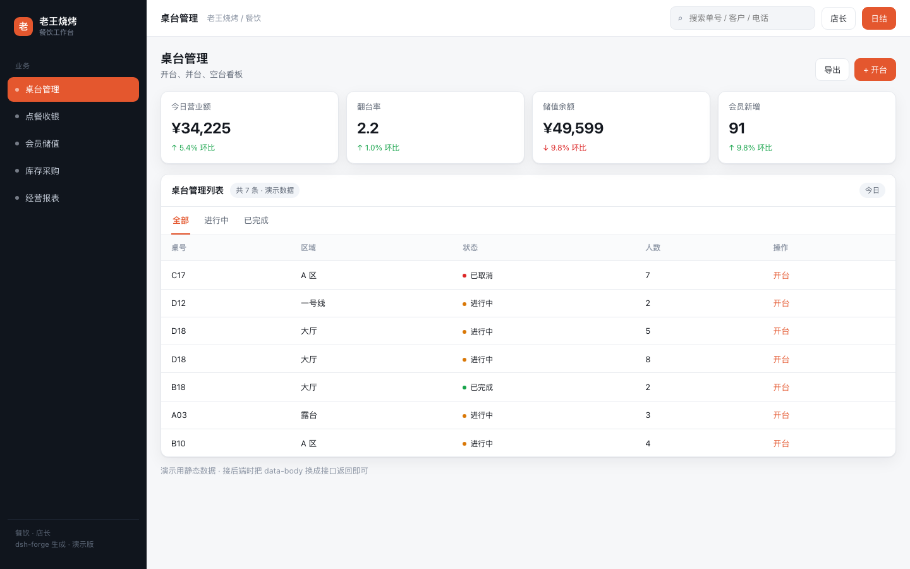

# dsh-forge · 千行百业工作台 & H5 制作器

**一句话需求 → PRD + 能点的 PC 工作台 + 能扫码的移动 H5 → 一条命令发到阿里云 nginx 拿公网地址。**

不是"又一个 PRD 写作工具"。它把**文档、界面、部署**串成一条流水线，产物是纯静态文件：没有构建步骤、没有外链 CDN、没有 npm 依赖。

覆盖 **143 个行业**（78 门店 + 65 公司）、**613 个业务模块**，全部由原型组合生成——加行业是加一行数据，不是写代码。




## 三种用法

### 1. 在 DSH 会话里（工具）

| 工具 | 作用 |
|---|---|
| `forge_verticals` | 列行业与模块矩阵（可按 store / company 过滤） |
| `forge_build` | 生成 PRD(md+html) + 工作台 + H5 |
| `forge_deploy` | 发布到阿里云，返回公网 URL；支持 `dryRun` / `rollback` |
| `forge_sites` | 列已发布站点 |

### 2. 在终端里（同源实现）

```bash
node cli.mjs verticals --kind store          # 78 个门店业态
node cli.mjs build  --project "老王烧烤" --vertical 火锅 --site laowang --out ./out
node cli.mjs deploy --dir ./out/laowang --site laowang
node cli.mjs deploy --dir ./out/laowang --site laowang --rollback
node cli.mjs sites
```

### 3. 字典外的行业（不阻塞）

```bash
node cli.mjs build --project "社区牙科" --vertical "口腔门诊" \
  --modules "患者档案,预约,收费,复诊" --site kq01
```

## 产物长什么样

```
out/<site>/
├── prd.md              # 六段式 PRD（背景与非目标 / 用户与场景 / 功能清单 /
│                        # 交互与字段规则 / 验收标准 / 上线与埋点）
├── prd.html            # 可直接分享的排版版
├── console/index.html  # PC 工作台：侧边栏模块、KPI 卡、可搜索表格、新增行
├── h5/index.html       # 移动端：KPI 条、功能宫格、动态列表、底部抽屉、tabbar
└── manifest.json       # 站点元数据
```

演示数据按字段语义生成（金额带 ¥、比率一位小数、车牌/手机号/日期各自成形），不是"待定/示例"占位符。

## 架构：为什么能"千行百业"

```
data/archetypes.json   20 个原型模块（开单/会员/预约/库存/课程/工单/项目/
                       客户/排班/结算/合同/合规/报表/设备/排队/配送/质检/患者/处方）
data/verticals.json    20 个手调精选行业（模块命名更贴业务）
data/industries.json   137 行行业元组 → 引用 archetypes 组合
```

一行行业 = `[id, 名称, store|company, 副标题, 主色, 角色, 痛点, 4 个 KPI, 模块组合, 可选的改名]`：

```json
["coldchain", "冷链", "company", "冷库 / 冷链运输 / 生鲜", "#2C7A7B", "运营经理",
 "温控记录、库容调度、货损", "在途车次,温控达标,库容占用,货损率",
 "delivery,inventory,asset,report"]
```

改一个原型的字段，所有引用它的行业一起变；改一行的 tweaks，只影响那个行业。精选行业优先，id/名称重复的行业行自动跳过。

## 部署模型（不踩既有站点）

服务器是宝塔结构，80 端口 default_server 在 `00-ga-docs.conf`（root `/var/www/ga-docs`），`/arena/` 就是外挂式子路径。forge 沿用同一套路，**不改任何 nginx 配置**：

```
本地 out/<site>/   →  /www/wwwroot/forge/<site>/      （只写这一个目录）
软链（只建一次）    →  /var/www/ga-docs/forge -> /www/wwwroot/forge
备份               →  /www/wwwroot/forge/.prev-<时间戳>-<pid>，保留最近 3 个
访问               →  http://<公网IP>/forge/<site>/console/
```

- 只写 `/www/wwwroot/forge/`，站点间互不影响
- 上传前自动备份，`--rollback` 用 `cp -a` 整目录替换（不依赖远端 git）
- 每次部署重生 `/www/wwwroot/forge/index.html` 站点索引
- 收尾跑 `nginx -t` 兜底；配置没变就不 reload
- SSH 走本机 `~/.ssh/config` 的别名（默认 `aliyun`），**仓库里没有任何密钥**

## 边界（别当成品用）

- 产物是**静态演示**：数据内联在页面里，接后端时替换 `data-body`，别在演示里假装接口已通
- 只有 HTTP（IP + 路径）。独立域名 + HTTPS 需要先在 DNS 加记录
- 无登录 / 权限 / 多租户：PRD 写了规则，演示不实现
- H5 是移动端网页，不是小程序工程

## 已知取舍

- 组合式行业的字段来自原型，同原型跨行业共用字段名；需要更贴业务的字段就在 `tweaks` 里覆盖或加精选行业
- 精选 20 个是手调的，质量高于组合结果；新行业建议先进 `industries.json`，跑通后再升级为精选

## 目录

```
dsh-forge/
├── index.js              # DSH 插件入口（4 个工具 + 用法提示）
├── cli.mjs               # 终端入口，与插件同源
├── lib/core.mjs          # 行业组合 / PRD / Demo / 部署
├── data/archetypes.json  # 原型模块库
├── data/verticals.json   # 精选行业
├── data/industries.json  # 行业元组（137 行）
├── templates/app.css     # 设计系统（工作台 + H5 共用）
└── docs/screenshots/     # 实际渲染截图
```

MIT。PRD 结构与功能思路为自行实现，未使用第三方源码。
